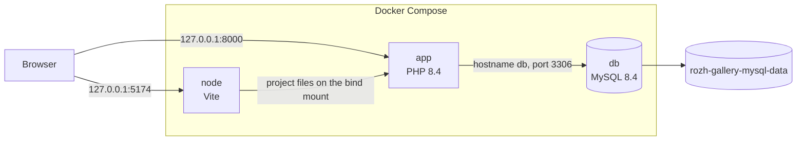
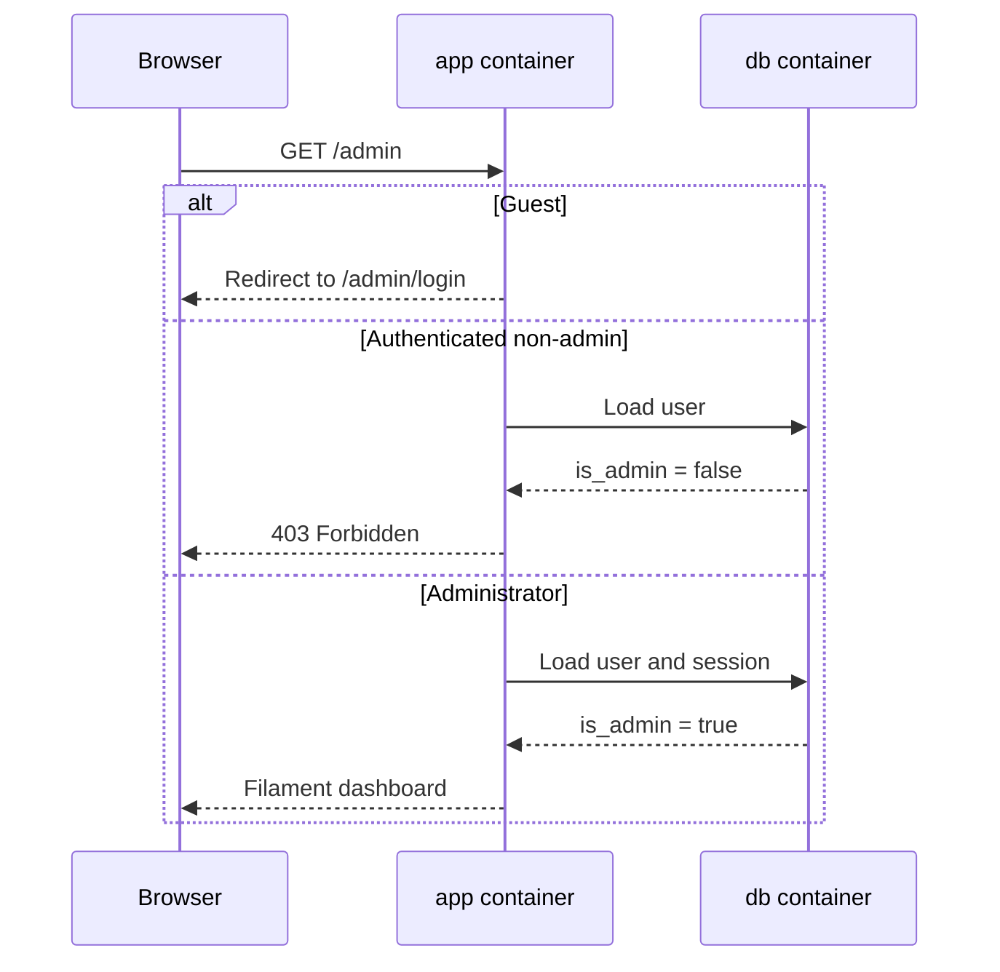

# Rozh Gallery

Laravel 12 application with a Filament 4 admin panel, Sanctum API authentication, and a Docker Compose environment for local development.

[](https://www.php.net/)
[](https://laravel.com/)
[](https://filamentphp.com/)
[](https://livewire.laravel.com/)
[](https://www.mysql.com/)
[](https://laravel.com/docs/sanctum)
[](https://vite.dev/)
[](https://docs.docker.com/compose/)

## Project overview

Rozh Gallery is a Laravel application prepared for local development in Docker. The repository currently contains the application foundation: the HTTP shell, database-backed sessions, cache, and queues, a Filament admin panel, and a Sanctum guard for the current-user API.

The admin panel is not open to every authenticated user. The `users.is_admin` column defaults to false, and `User::canAccessPanel()` allows only an administrator into the `admin` panel. Guests are redirected to the login page. An authenticated non-admin receives HTTP 403.

Shop domains such as categories, tags, products, blog posts, carts, orders, and payments are not implemented in this repository.

## Main features

| Area | What is implemented |
| --- | --- |
| Admin panel | Filament 4 at `/admin`, with login and a dashboard |
| Authorization | Server-side `FilamentUser` check on `is_admin` |
| Admin provisioning | Interactive `php artisan make:admin` command |
| API authentication | Laravel Sanctum token guard |
| Application health | Laravel health route at `/up` |
| Persistence | MySQL 8.4 for application data, sessions, cache, and queues |
| Frontend tooling | Vite 7 and Tailwind CSS 4 for asset build and development |
| Local runtime | Docker Compose services for PHP, MySQL, and Node |

## Technology stack

| Component | Version in this project |
| --- | --- |
| PHP | 8.4 |
| Laravel | 12.73 |
| Filament | 4.17 |
| Livewire | 3.8 |
| Laravel Sanctum | 4.5 |
| MySQL | 8.4 |
| Node.js | 22 LTS, used only by the asset service |
| Vite | 7 |
| Tailwind CSS | 4 |

Versions above match `composer.lock` and the Docker images. Do not upgrade them as part of routine local setup.

## Architecture overview

The browser talks to the PHP service. That service talks to MySQL over the Compose network. Vite is a separate, optional service used only while building or watching frontend assets. It is not started by a normal `docker compose up`.



A normal web request stays inside `app` until Laravel needs the database. Sessions, cache, and queues use the same MySQL service, so no Redis container is part of this setup.



## Requirements and prerequisites

- Docker Engine and the Docker Compose plugin
- Git
- A free local port `8000` for the application
- A free local port `3308` for published MySQL access
- A free local port `5174` when you run the Vite development server

PHP, Composer, Node.js, and MySQL do not need to be installed on the host. The containers provide them.

This machine already has other listeners. `127.0.0.1:3306` belongs to the original `rozh-gallery-mysql` container, and `3307` belongs to a different project. The Compose database is published on `127.0.0.1:3308` so those listeners stay untouched.

## Installation and setup

### Quick start for a new clone

From the repository root:

```bash
cp .env.example .env
docker compose up -d --build
docker compose exec app php artisan key:generate
docker compose exec app composer install
docker compose run --rm node npm install
docker compose run --rm node npm run build
docker compose exec app php artisan migrate
docker compose exec app php artisan make:admin
```

Open <http://localhost:8000>. The admin panel is <http://localhost:8000/admin/login>.

`make:admin` asks for a name, an email address, a hidden password, and a confirmation. The password is hashed by Laravel and is not printed. The new user is stored with `is_admin` set to true. Use this command rather than `make:filament-user`, which cannot grant panel access.

### Existing local database

If you are working in the environment that already has the original MySQL container, do not create a second empty application database and do not run `migrate:fresh`. Follow [Database backup and restore](#database-backup-and-restore). The current data was copied into the Compose volume from a logical backup. The original container and its volume are still present.

## Docker architecture and services

| Service | Image | Purpose | Published port | Started by `up` |
| --- | --- | --- | --- | --- |
| `app` | Local build from `Dockerfile` (`php:8.4-cli`) | Laravel development server, Artisan, Composer, PHPUnit | `127.0.0.1:8000` | Yes |
| `db` | `mysql:8.4` | Application and test databases | `127.0.0.1:3308` | Yes |
| `node` | `node:22-bookworm` | `npm install`, Vite build, Vite dev server | `127.0.0.1:5174` | No |

`node` belongs to the Compose profile `assets`. `docker compose up` does not start it. `docker compose run node ...` still works.

Inside `app`, the database hostname is the service name `db` and the port is `3306`. Compose injects those values. The development server is started with `php artisan serve --no-reload` so it keeps them. Without that flag, Laravel removes container variables when `.env` exists and the web process falls back to `127.0.0.1`. Host programs that run outside Docker use `127.0.0.1` and the published port `3308`. Changing `.env` does not restart this server. Recreate `app` after an environment change that the web process must see:

```bash
docker compose up -d --force-recreate --no-deps app
```

MySQL data is stored in the named volume `rozh-gallery-mysql-data`, mounted at `/var/lib/mysql` in the `db` container. Stopping or recreating the container does not remove that volume. `docker compose down -v` would delete it. Do not run that command against this project.

The application source is bind-mounted into `app` and `node` at `/var/www/html`. Code changes on the host are visible immediately. The PHP process runs as the same user id as the file owner, which keeps `storage` and `bootstrap/cache` writable.

## Environment configuration

Copy the example file once:

```bash
cp .env.example .env
```

Set these values yourself. Do not commit `.env`.

| Variable | Local meaning |
| --- | --- |
| `APP_KEY` | Application encryption key. Generate it with Artisan. Keep the existing key if the database already contains encrypted data. |
| `APP_URL` | Public origin. Compose sets `http://localhost:8000` inside `app`. |
| `DB_DATABASE` | `rozh_gallery` |
| `DB_USERNAME` | Database user, `rozh` in the example |
| `DB_PASSWORD` | Password for that user. Compose also uses it as the local MySQL root password. |
| `DB_HOST` | `127.0.0.1` for host tools. Ignored inside `app`, where Compose sets `db`. |
| `DB_PORT` | `3308` for host tools. Ignored inside `app`, where Compose sets `3306`. |

`SESSION_DRIVER`, `CACHE_STORE`, and `QUEUE_CONNECTION` are `database`. They use the MySQL service. Redis variables in `.env.example` are unused defaults from the Laravel skeleton.

PHPUnit reads `phpunit.xml`. `DB_HOST` and `DB_PORT` there do not overwrite variables already provided by Compose, so tests inside `app` reach the `db` service and the `rozh_gallery_testing` database. They do not refresh `rozh_gallery`.

## Running the application

Start the PHP and MySQL services and wait until their health checks pass:

```bash
docker compose up -d --build --wait
```

Stop them without deleting data:

```bash
docker compose stop
```

Start them again after a stop:

```bash
docker compose start
```

Follow logs:

```bash
docker compose logs -f app db
```

Remove the containers and keep the named volume:

```bash
docker compose down
```

Do not add `-v`.

### Local URLs

| URL | Response |
| --- | --- |
| <http://localhost:8000> | Welcome page |
| <http://localhost:8000/up> | Health check |
| <http://localhost:8000/admin/login> | Filament login |
| <http://localhost:8000/admin> | Dashboard for an administrator, otherwise redirect or 403 |
| <http://localhost:8000/api/user> | Current user when a Sanctum token is sent |

## Laravel Artisan commands

Run Artisan inside the application container:

```bash
docker compose exec app php artisan <command>
```

Examples:

```bash
docker compose exec app php artisan migrate
docker compose exec app php artisan test
docker compose exec app php artisan make:admin
docker compose exec app php artisan route:list
```

Create the first administrator only through `make:admin`. The command prompts for the name, email, and password. Nothing in the repository should contain that password.

Queue workers and the scheduler are not separate containers. The defaults use the database driver. Start them only when you are working on queued jobs:

```bash
docker compose exec app php artisan queue:listen --tries=1 --timeout=0
docker compose exec app php artisan schedule:work
```

## Composer and NPM commands

Install or update PHP dependencies inside the container that matches the project PHP version:

```bash
docker compose exec app composer install
```

Install JavaScript dependencies:

```bash
docker compose run --rm node npm install
```

Build production assets into `public/build`:

```bash
docker compose run --rm node npm run build
```

Run the Vite development server so the browser can reach it from the host:

```bash
docker compose run --rm --service-ports node npm run dev -- --host 0.0.0.0 --port 5174
```

Vite is fixed to port `5174` because `5173` is often already taken. The development server origin is `http://localhost:5174`. Stop it with Ctrl+C. The `--rm` flag removes that temporary container and does not affect MySQL.

## Database migrations

Apply outstanding migrations:

```bash
docker compose exec app php artisan migrate
```

On a database that was restored from the existing Rozh Gallery backup, this command should report that nothing needs to run. It must not delete users.

Create the empty test database manually only if the Compose init script did not run, which happens when the volume already contains data. The script is idempotent:

```bash
docker compose exec db sh /docker-entrypoint-initdb.d/01-create-testing-database.sh
```

Never run `php artisan migrate:fresh`, `php artisan db:wipe`, or `docker compose down -v` against the development database.

## Database backup and restore

### Where the data lives

| Store | What it contains | Safe to delete |
| --- | --- | --- |
| Named volume `rozh-gallery-mysql-data` | Current Compose database | No |
| Original container `rozh-gallery-mysql` | Previous MySQL 8.4 server on `127.0.0.1:3306` | No, until you have verified the new copy |
| Anonymous volume mounted at `/var/lib/mysql` in that original container | Previous data files | No |
| `backups/*.sql` | Logical dumps | Keep at least one dump. The directory is gitignored. |

The original container uses restart policy `unless-stopped`. Leave it in place as a recovery source. Stopping it is optional after you have compared row counts and signed in with the existing administrator. Removing the container or its volume is a separate, manual decision.

### Create a backup

```bash
mkdir -p backups
docker compose exec -T db sh -c 'mysqldump -uroot -p"$MYSQL_ROOT_PASSWORD" --single-transaction --routines --triggers --events --no-tablespaces --set-gtid-purged=OFF --default-character-set=utf8mb4 --databases rozh_gallery rozh_gallery_testing' > backups/rozh_gallery-$(date +%F-%H%M%S).sql
chmod 600 backups/*.sql
```

The dump contains password hashes. Do not commit it, paste it into a ticket, or print it.

### Restore a backup

Restoring replaces tables in the databases named by the dump. Confirm the filename before you run it.

```bash
docker compose exec -T db sh -c 'mysql -uroot -p"$MYSQL_ROOT_PASSWORD"' < backups/your-backup.sql
```

### Recovery from the original container

If the Compose database is wrong and the original container is still running:

```bash
docker exec rozh-gallery-mysql sh -c 'mysqldump -uroot -p"$MYSQL_ROOT_PASSWORD" --single-transaction --routines --triggers --events --no-tablespaces --set-gtid-purged=OFF --default-character-set=utf8mb4 --databases rozh_gallery rozh_gallery_testing' > backups/restore-from-original.sql
docker compose exec -T db sh -c 'mysql -uroot -p"$MYSQL_ROOT_PASSWORD"' < backups/restore-from-original.sql
```

The file `backups/rozh_gallery-pre-compose.sql` is the dump taken immediately before the Compose database was loaded, when that migration was performed on this machine.

## Running tests

```bash
docker compose exec app php artisan test
```

Feature tests that use `RefreshDatabase` rebuild `rozh_gallery_testing` only. The `rozh_gallery` database, including the administrator, stays in place.

A passing suite currently covers the welcome page, guest denial, non-admin denial, administrator access, mass-assignment protection for `is_admin`, and the `make:admin` command.

## Filament admin panel

The panel id is `admin` and its path is `/admin`.

| Visitor | Result |
| --- | --- |
| Guest | Redirect to `/admin/login` |
| User with `is_admin` false | Login form rejects the account. A direct request returns 403. |
| User with `is_admin` true | Dashboard |

`is_admin` is not mass assignable. Registration or `User::create()` cannot set it. `make:admin` assigns it explicitly and hashes the password through the model cast.

Sign-in URL: <http://localhost:8000/admin/login>

## API overview

The only application API route is the Sanctum current-user endpoint.

| Method | Path | Authentication | Success | No credentials |
| --- | --- | --- | --- | --- |
| `GET` | `/api/user` | `Authorization: Bearer <token>` | JSON user | `401` with `{"message":"Unauthenticated."}` |

Send `Accept: application/json`. Without that header Laravel treats the request as a browser visit and looks for a web `login` route, which this application does not define.

```bash
curl -H 'Accept: application/json' http://localhost:8000/api/user
```

Issue a token from your own authenticated client code or a controlled Artisan session when an API client is added. No public catalog or checkout endpoints exist yet.

## Project directory structure

```text
.
├── app/
│   ├── Console/Commands/CreateAdminCommand.php
│   ├── Models/User.php
│   └── Providers/Filament/AdminPanelProvider.php
├── database/migrations/
├── docker/
│   ├── entrypoint.sh
│   └── mysql/init/01-create-testing-database.sh
├── routes/
│   ├── api.php
│   ├── console.php
│   └── web.php
├── tests/Feature/AdminPanelAccessTest.php
├── compose.yaml
├── Dockerfile
└── vite.config.js
```

`vendor`, `node_modules`, `.env`, and `backups` are local or generated. They are not part of the Git history.

## Troubleshooting

| Symptom | What to check |
| --- | --- |
| `app` exits before MySQL is ready | `docker compose ps` and `docker compose logs db`. The app waits for the database health check. |
| `DB_PASSWORD is required` | `.env` has an empty `DB_PASSWORD`, or Compose was started from another directory. |
| Host Artisan cannot connect | Host tools must use `127.0.0.1:3308`. Inside Compose the host is `db` and the port is `3306`. |
| Web pages report connection refused to `127.0.0.1:3306` | Confirm `app` was started with `php artisan serve --no-reload`, then run `docker compose up -d --force-recreate --no-deps app`. |
| `GET /api/user` in a browser shows an error page | Call it with `Accept: application/json`. The unauthenticated API response is HTTP 401. |
| Port `8000`, `3308`, or `5174` is in use | Stop the other listener or change only the published port in `compose.yaml`. Keep the internal MySQL port at `3306`. |
| `/admin` returns 403 after login | The account has `is_admin` false. Create an administrator with `make:admin`. |
| `make:admin` crashes with `stty: invalid argument` | Run it through `docker compose exec app php artisan make:admin`. The command also falls back to Symfony questions because this host's `stty` can reject Laravel Prompts. If the terminal stops echoing, run `reset`. |
| Vite assets fail in the browser | Start Vite with the documented port `5174`. Another project may already own `5173`. |
| Tests try to refresh the wrong database | Run them with `docker compose exec app php artisan test`, not against a shell where `DB_DATABASE` is already exported as `rozh_gallery`. |
| Permission errors in `storage` | The container user id must match the host owner. The default build arg is `UID=1000`. Rebuild with `UID=$(id -u) GID=$(id -g) docker compose up -d --build`. |
| Data disappeared after Compose changes | Check that the volume `rozh-gallery-mysql-data` still exists with `docker volume ls`. Restore `backups/rozh_gallery-pre-compose.sql` or dump the original container. Do not recreate the volume. |

## Security notes

- `.env`, database dumps, and `vendor` are gitignored. Do not force-add them.
- Compose reads `DB_PASSWORD` from `.env`. The Compose file does not contain the password.
- The image build does not copy `.env`.
- MySQL is published only on `127.0.0.1`, not on every network interface.
- The local root password matches `DB_PASSWORD` so a second secret is not required for development. Use a distinct root password if this Compose file is ever deployed beyond one machine.
- Administrator passwords are entered interactively and stored only as Laravel hashes.
- Panel access is enforced in `canAccessPanel()`, not by hiding a menu.

## Development workflow

1. Create a branch from `main`.
2. Start the stack with `docker compose up -d --build`.
3. Make the change inside `app`, `routes`, `database`, or `resources`.
4. If the schema changes, add a migration and run `docker compose exec app php artisan migrate`. Do not edit migrations that have already run on the shared database.
5. Run `docker compose exec app php artisan test`.
6. If CSS or JavaScript changed, run the Vite build or the Vite dev server.
7. Review `git status` and leave `.env`, `backups`, `vendor`, and `node_modules` untracked.

Business rules for future shop features do not belong in controllers or Filament resources. This repository does not add those features yet.

## Contribution guidelines

- Open an issue or a pull request against `main` with a short description of the behavior change.
- Keep Docker, PHP, and JavaScript dependency versions pinned to the versions documented above unless the pull request is explicitly an upgrade.
- Include or update a PHPUnit test for access control, validation, and database behavior.
- Do not commit secrets, dumps, or machine-specific `.env` values.
- Do not add destructive migration commands to documentation examples or automation.

Report security issues privately to the repository owner. Do not open a public issue that includes credentials, dumps, or exploit details.
